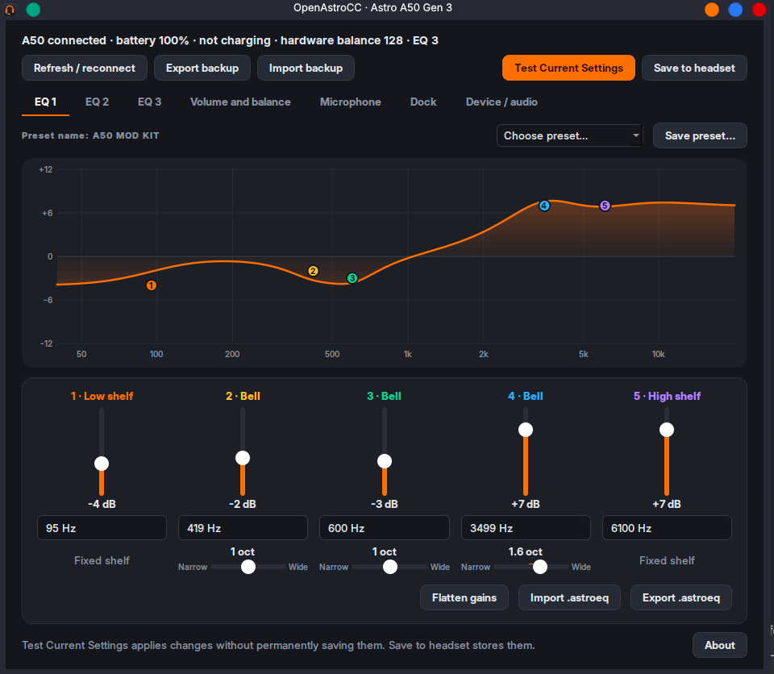
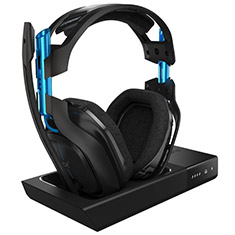

# OpenAstroCC

**An open-source Astro A50 Gen 3 Command Center for Linux.**

Change your EQ, adjust your microphone and sidetone, manage presets, and
configure Game/Voice audio—without going back to Windows.



## What is it?

OpenAstroCC is a desktop control panel for the **Astro A50 Gen 3**
headset and base station (USB `9886:0015`).

- **Equalizer:** Drag the five EQ points, tune frequencies and bandwidth,
  or choose an Astro or custom preset.
- **Headset controls:** Adjust sidetone, mic settings, Game/Voice balance
  and dock options. Check battery and charging status.
- **Audio:** Set up separate 5.1 Game, stereo Voice and microphone devices.
- **Backups:** Export your headset configuration and restore it later.

### Supported headset



## Installation

### AppImage (Linux x86_64)

Download an AppImage from [GitHub Releases](https://github.com/BenStein1/OpenAstroCC/releases)
when a tagged version is available. Until then, or to build the latest source:

```bash
git clone https://github.com/BenStein1/OpenAstroCC.git
cd OpenAstroCC
bash scripts/build_appimage_local.sh
./dist/OpenAstroCC-x86_64.AppImage
```

If an older AppImageLauncher prevents it from opening, use
`./dist/AppDir/AppRun` instead. See [AppImage troubleshooting](docs/APPIMAGE.md).

### Run from source

With Python 3 and PyQt6 installed:

```bash
python3 tools/a50_gui.py
```

## Usage

1. **Choose a preset** or drag the colored EQ points to shape the sound.
2. Click **Test Current Settings** to apply the changes to the headset
   without permanently saving them.
3. Click **Save to headset** when you want to keep those settings.
   **Save preset…** saves an EQ file for reuse instead.

To configure Linux audio channels, open **About → Audio setup…** and preview
the suggested configuration before installing it.

## Documentation

- [Audio setup](docs/AUTO-AUDIO-SETUP.md) — device detection and routing
- [Application guide](docs/NATIVE-APP.md) — EQs, presets, controls and saving
- [AppImage guide](docs/APPIMAGE.md) — builds, configuration and troubleshooting
- [Developer guide](docs/GEN3-IMPLEMENTATION-GUIDE.md) — USB/HID protocol and reverse engineering
- [Development and testing](docs/DEVELOPMENT.md) — validation and remaining work

## Contributing

Issues, fixes, testing and pull requests are welcome. Please include your
headset generation and USB ID when reporting hardware behavior.

## Experimental support

Currently tested on **A50 Gen 3 / Europa (`9886:0015`)**. Other Astro
headsets are not confirmed compatible. Automatic Linux audio routing and
some persistence/reconnection cases still need wider hardware testing.
See the [feature status](docs/FEATURES.md).

## License

[GPL-3.0-only](LICENSE). OpenAstroCC is an independent project, not
affiliated with Astro Gaming or Logitech. See [third-party notices](docs/THIRD_PARTY_NOTICES.md)
for attribution and vendor preset redistribution considerations.
